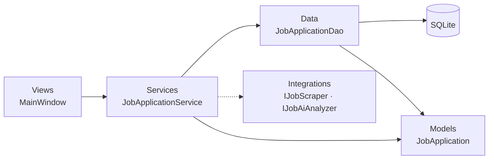
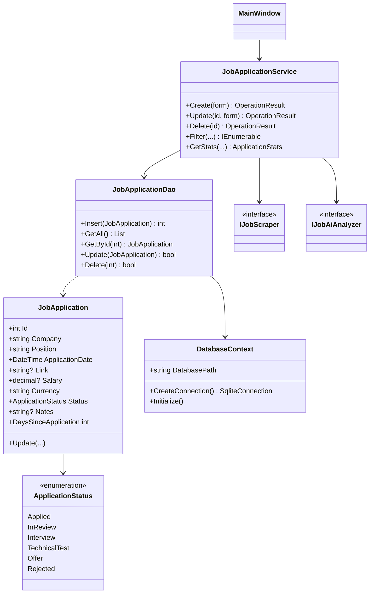

# JobTracker — Gestor de postulaciones laborales

> Parcial final · Programación con C# y .NET

## 1. Información general

| | |
|---|---|
| **Proyecto** | JobTracker |
| **Estudiante** | _Edinso Barros Lopez_ |
| **Repositorio** | _https://github.com/Elobar/Parcial-JobTracker_ |

**Descripción.** JobTracker es una aplicación de escritorio para llevar el control de los procesos de selección a los que se postula una persona: empresa, cargo, fecha, enlace de la oferta, salario ofrecido, estado del proceso y notas.

**Problema que resuelve.** Quien busca empleo se postula a muchas ofertas en distintas páginas y termina con enlaces, correos y fechas dispersos. No sabe a qué empresas ya escribió, en qué etapa va cada proceso ni cuánto ofrecían.

**Objetivo.** Centralizar las postulaciones en un solo lugar, con una vista clara del avance de cada proceso, guardando la información de forma persistente en una base de datos SQLite.

## 2. Funcionalidades

- **Registrar** una postulación (empresa, cargo, fecha, estado, salario y moneda, enlace, notas).
- **Consultar** todas las postulaciones en una lista, ordenadas de la más reciente a la más antigua.
- **Buscar** por empresa o cargo y **filtrar** por estado.
- **Editar** una postulación seleccionándola en la lista (por ejemplo, al pasar de _Postulado_ a _Entrevista_).
- **Eliminar** una postulación, con confirmación previa.
- **Embudo de estados** en la parte superior: cuántas postulaciones hay en cada etapa.
- **Validaciones** con mensajes claros: empresa y cargo obligatorios, fecha no futura, enlace `http(s)`, salario numérico y no negativo.
- **Abrir el enlace** de la oferta en el navegador.
- **Notificaciones** al guardar, editar o eliminar.
- **Persistencia**: los datos siguen disponibles al cerrar y volver a abrir el programa.

## 3. Tecnologías utilizadas

| Tecnología | Detalle |
|---|---|
| .NET | 10.0 (`net10.0`) |
| Lenguaje | C# 12 |
| Interfaz gráfica | Avalonia UI 11.3 (XAML `.axaml`, tema Fluent) |
| Acceso a datos | ADO.NET con `Microsoft.Data.Sqlite` 8.0 |
| Base de datos | SQLite |
| Paquetes adicionales | `Avalonia.Desktop`, `Avalonia.Themes.Fluent`, `Avalonia.Fonts.Inter` |

No se usa Entity Framework ni ningún otro ORM.

## 4. Estructura del proyecto

```
JobTracker/
├── JobTracker.csproj
├── Program.cs                      # Punto de entrada
├── App.axaml / App.axaml.cs        # Aplicación Avalonia (tema y ventana inicial)
├── Models/
│   ├── JobApplication.cs           # Entidad principal
│   └── ApplicationStatus.cs        # Enum con las etapas del proceso
├── Data/
│   ├── DatabaseContext.cs          # Ruta de la BD, conexiones y creación de la tabla
│   └── JobApplicationDao.cs        # Acceso a datos: CRUD con ADO.NET
├── Services/
│   ├── JobApplicationService.cs    # Validaciones y reglas del programa
│   ├── JobApplicationForm.cs       # Datos del formulario + estadísticas
│   ├── OperationResult.cs          # Resultado (éxito / errores) de una operación
│   └── Integrations/               # Puntos de conexión para bots e IA (futuro)
│       ├── IJobScraper.cs
│       ├── IJobAiAnalyzer.cs
│       └── JobPosting.cs
├── UI/
│   └── ApplicationCard.cs          # Adaptador para mostrar cada fila de la lista
├── Views/
│   ├── MainWindow.axaml            # Interfaz (XAML)
│   └── MainWindow.axaml.cs         # Eventos de la interfaz
├── Database/schema.sql             # Esquema de la base de datos (referencia)
└── evidencias/                     # Capturas de las pruebas
```

### Clases principales y responsabilidades

| Clase | Responsabilidad |
|---|---|
| `JobApplication` | Representa una postulación y protege sus datos. |
| `ApplicationStatus` | Enumera las etapas: Postulado, En revisión, Entrevista, Prueba técnica, Oferta, Rechazado. |
| `DatabaseContext` | Sabe dónde está el archivo SQLite, entrega conexiones y crea la tabla. |
| `JobApplicationDao` | Ejecuta el SQL (INSERT, SELECT, UPDATE, DELETE). Es la única clase que escribe SQL. |
| `JobApplicationService` | Valida los datos y coordina la ventana con el DAO. |
| `MainWindow` | Recibe los eventos del usuario y muestra resultados. No contiene SQL ni validaciones. |
| `ApplicationCard` | Convierte una `JobApplication` en lo que necesita la lista (textos y colores). |

### Arquitectura por capas



### Dónde se aplica POO

- **Clases y objetos:** `JobApplication`, `JobApplicationDao`, `JobApplicationService`, `DatabaseContext`, `ApplicationCard`.
- **Propiedades y constructores:** `JobApplication` tiene dos constructores (postulación nueva y postulación leída de la base de datos).
- **Encapsulamiento:** las propiedades de `JobApplication` tienen `set` privado; solo se modifican con el método `Update`, que además normaliza los textos. El `Id` solo lo asigna el DAO (`internal set`).
- **Separación de responsabilidades:** interfaz (`Views`), lógica (`Services`) y acceso a datos (`Data`) están en carpetas y clases distintas.
- **Abstracción e interfaces:** `IJobScraper` e `IJobAiAnalyzer` definen contratos que hoy cumplen `NullJobScraper` y `NullJobAnalyzer` (patrón _Null Object_). Se justifican porque permiten conectar bots e IA reales sin modificar el resto del programa.
- **Enumeraciones:** `ApplicationStatus` evita usar textos sueltos para los estados.



## 5. Instalación de dependencias

1. **Instalar el SDK de .NET 8** (o superior) desde <https://dotnet.microsoft.com/download>. Para verificar:
   ```bash
   dotnet --version
   ```
   Si tienes un SDK más nuevo (9 o 10), abre `JobTracker.csproj` y cambia `<TargetFramework>net8.0</TargetFramework>` por la versión que tengas (`net9.0`, `net10.0`).
2. **Instalar Git** y obtener el código:
   ```bash
   git clone <https://github.com/Elobar/Parcial-JobTracker>
   cd <cd Parcial-JobTracker>
   ```
   (Entra a la carpeta donde está el archivo `JobTracker.csproj`.)
3. **Restaurar las dependencias** (descarga los paquetes NuGet):
   ```bash
   dotnet restore
   ```

Paquetes que se restauran automáticamente: `Avalonia`, `Avalonia.Desktop`, `Avalonia.Themes.Fluent`, `Avalonia.Fonts.Inter` y `Microsoft.Data.Sqlite`. No se necesita instalar SQLite aparte ni ninguna otra configuración.

## 6. Ejecución del programa

Desde la carpeta que contiene `JobTracker.csproj`:

```bash
dotnet restore
dotnet run
```

Se abrirá la ventana de la aplicación. Para compilar sin ejecutar: `dotnet build`.

## 7. Base de datos

**Qué almacena.** Las postulaciones laborales del usuario.

**Tabla `Applications`:**

| Campo | Tipo | Descripción |
|---|---|---|
| `Id` | INTEGER, PK, autoincremental | Identificador |
| `Company` | TEXT, obligatorio | Empresa |
| `Position` | TEXT, obligatorio | Cargo |
| `ApplicationDate` | TEXT, obligatorio | Fecha de postulación (`yyyy-MM-dd`) |
| `Link` | TEXT | Enlace de la oferta |
| `Salary` | REAL | Salario ofrecido (opcional) |
| `Currency` | TEXT, por defecto `COP` | Moneda |
| `Status` | TEXT, obligatorio | Etapa del proceso (nombre del enum) |
| `Notes` | TEXT | Notas |

**Conexión.** `DatabaseContext` construye la cadena de conexión con `SqliteConnectionStringBuilder` y entrega objetos `SqliteConnection` mediante `CreateConnection()`.

**Dónde están las operaciones CRUD.** En `Data/JobApplicationDao.cs`: `Insert` (Create), `GetAll` / `GetById` (Read), `Update` (Update) y `Delete` (Delete). Todas usan comandos parametrizados (`$company`, `$id`, …) y cierran la conexión con `using`.

**Creación de la base de datos.** Es automática: al iniciar, `DatabaseContext.Initialize()` ejecuta `CREATE TABLE IF NOT EXISTS`. No hay que ejecutar ningún procedimiento previo. El mismo esquema está en `Database/schema.sql` como referencia.

**Ubicación del archivo.** `jobtracker.db` se guarda en la carpeta de datos del usuario (`LocalApplicationData/JobTracker/`), por eso no se sube al repositorio y los datos se conservan al recompilar. La ruta exacta aparece en el pie de la ventana.

## 8. Evidencias de funcionamiento

> Guarda las capturas en la carpeta `evidencias/` con estos nombres y agrega una breve descripción debajo de cada una.

### Prueba 1 — Registro
**Acción:** agregar una postulación. **Resultado esperado:** se guarda en la base de datos y aparece en la lista.


## 9. Problemas encontrados y soluciones

**Problema: el salario no quedaba guardado como número en SQLite.**
`Microsoft.Data.Sqlite` guarda los valores `decimal` como texto (`TEXT`), por lo que la columna `Salary` (declarada `REAL`) terminaba con cadenas en lugar de números y no se podía ordenar ni comparar correctamente.

**Solución:** en `JobApplicationDao.AddParameters` el salario se convierte a `double` antes de enviarlo como parámetro, y al leer (`Map`) se convierte de nuevo a `decimal` con `reader.GetDouble`.

## 10. Ideas para continuar el proyecto

La aplicación ya trae **puntos de conexión** (marcados con `TODO(FUTURO ...)` en el código) para ampliarla sin reescribirla:

- `IJobScraper`: bots que lean ofertas desde páginas de empleo (por enlace o por búsqueda).
- `IJobAiAnalyzer`: IA que resuma ofertas y calcule la compatibilidad con el perfil.
- `JobApplicationService.ImportFromLinkAsync`: usado por el botón **Autocompletar desde el enlace**.
- `JobPosting`: formato común para las ofertas que entregue cualquier bot.
- Campos futuros en `JobApplication` (`Source`, `AiSummary`, `MatchScore`) y su migración en `DatabaseContext`.
